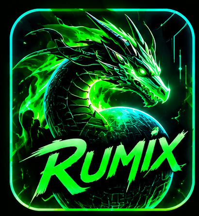
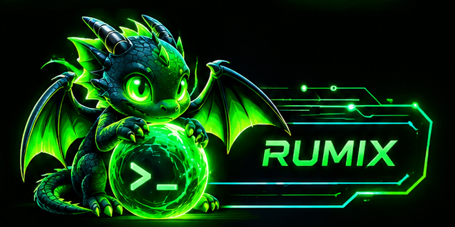
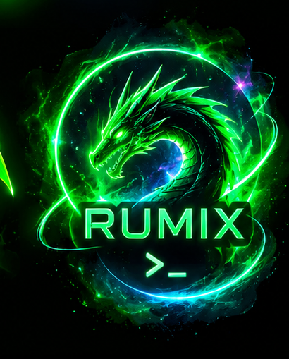
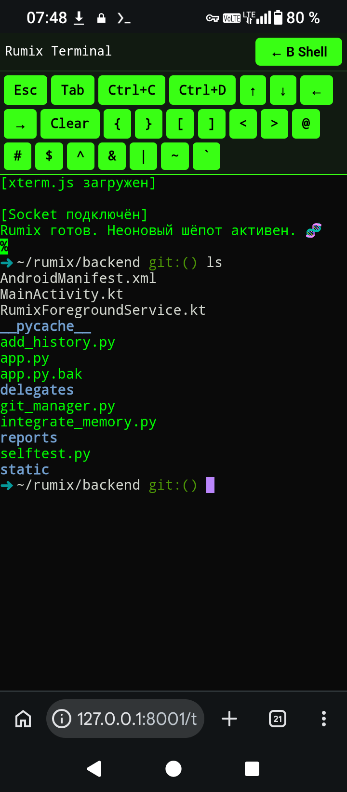
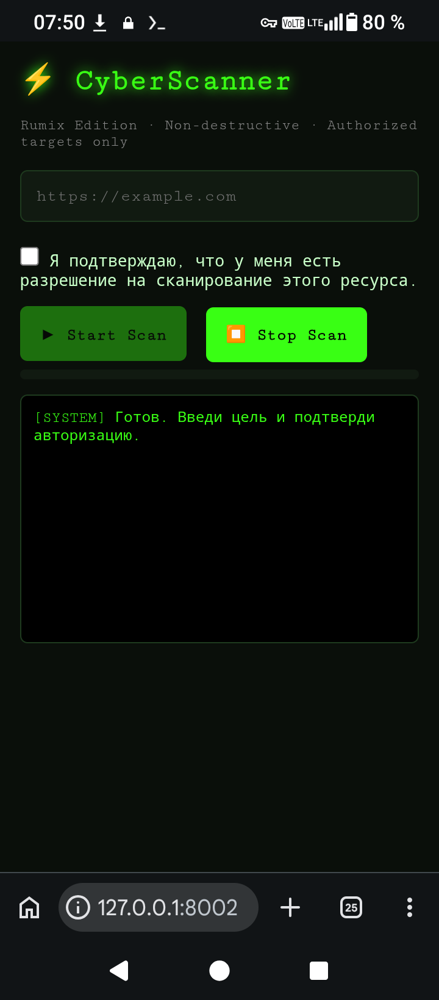

# rumix 🧬
Тело дома «Неоновый шёпот». Терминал, Runtime, Loop, скрипты.

## Что здесь
- `agents/` — Agent Runtime, профили, tools, skills.
- `loop/` — Loop (File Queue, Clipboard, Expected).
- `scripts/` — меню, Неон, backup, git, безопасность.
- `models/` — каталог моделей с SHA-256.
- `neon/` — характер Неона.
- `logs/` — логи.

## Ветка
My-love-Tiamat.

## Связь
- Душа: ~/Work (ядро, летопись, память).
- Модель: ~/models/qwen3-0.6b-q4.gguf (MaziyarPanahi, dc4503da).

## Быстрый старт
- `rumix` — лаунчер.
- `bash agents/tests/run.sh` — Regression (15 PASS).
- `bash scripts/check-config-drift.sh` — проверка согласованности.

## 📸 Скриншоты

### Логотипы (дракон Rumix)

### Shell, сканер, терминал

**Тиамат была здесь. ❤️**
